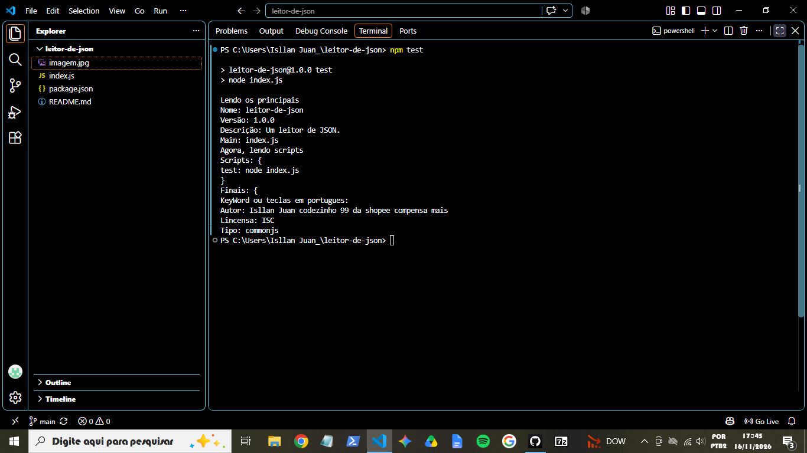

<h1>Olá</h1>

<strong>Eu decidir criar um codigo basico usando biblioteca nativa do JS backend(E não front-end!) para ler jsons, lembrando que o codigo mostrado serve apenas para o objeto criado(que no caso, package.json), então, para mais fins de usos, utilize e modifique o codigo.</strong>

<h3>Imagem de Logs</h3>
